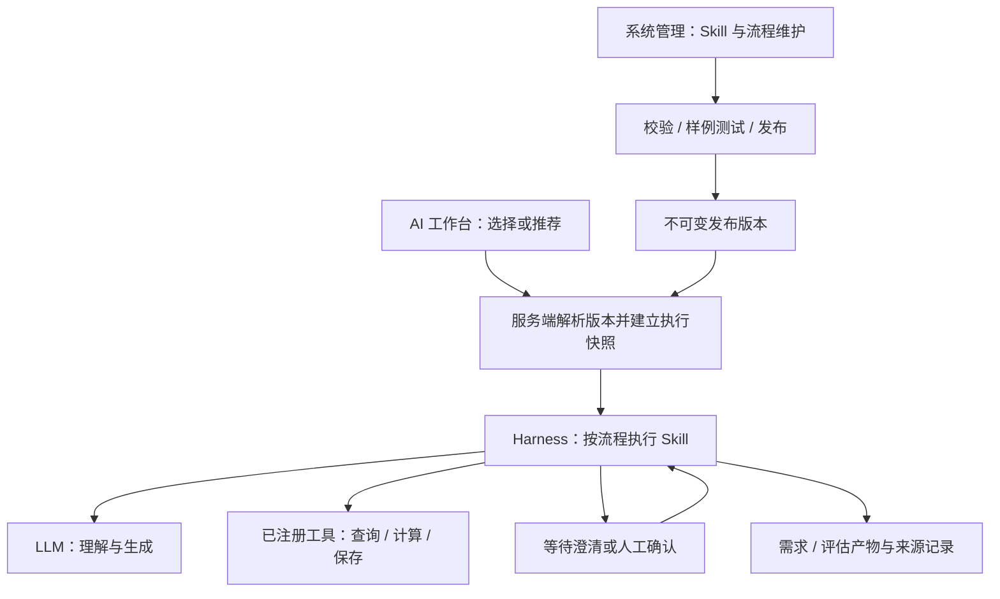

# WES 业务 Skill 与流程机制设计

日期：2026-11-02。状态：用户评审通过；A 批已在隔离分支实现、通过检查及用户界面验收，未合主线；B 批已获继续授权，C/D 未启动，完整 MVP 业务验收待执行。

评审记录：2026-11-02 用户明确回复“评审通过”，确认设计及其存储原则；随后回复“开始实施”，启动 A 批定义、清单与版本。本次仅测试库执行增量迁移，未执行生产迁移或开放发布。详细实施证据见分批计划第 5 节。

关联：ISS-2026-08-06-002 → RP-050（本轮扩展为 Skill 运行与治理机制）；RP-012（业务 Skill 场景）；RP-001（可视化设计器仍暂缓）。

## 1. 已确认的目标与范围

用户要求设计 Skill 清单、更新维护、版本控制和工作台调用机制。已明确：管理员在 WES 中维护全部 Skill 定义，包括输入输出结构、提示词和工具配置；管理入口沿用系统管理，调用入口沿用 AI 工作台。

概念范围：系统管理下增加 Skill 管理、流程管理；管理员维护、试运行、发布和回滚；业务用户通过工作台调用。首批用需求拆解、需求澄清、实施评估匹配三个 Skill 验证已有 MVP 标准：上传一份需求 Excel，经必要澄清，得到有需求依据、可人工调整、可保存并刷新恢复的实施评估。

本文为已评审的产品与架构方案；后续实现状态以分批计划为准，不把后续设计当作已实现能力。分批计划见 `../plans/2026-11-02-wes-business-skills.md`；不创建实现 Loop，A 批验证仅使用独立测试库。

## 2. 当前实现与复用边界

本节记录设计时主线基线；A 批新增的定义仓储、管理路由和页面目前仅在隔离分支完成，主线与工作台尚未接入。

| 当前事实 | 证据 | 本方案如何使用 |
| --- | --- | --- |
| 有工具注册、能力过滤、工具策略及确认闸门 | `apps/api/src/agent/tool-registry.ts`、`agent/tool-policy.ts`、`services/ai/workbench-tool-approval.ts` | 复用工具执行与权限约束；不再复制工具目录 |
| 有结构化输出契约及模型输出校验 | `apps/api/src/ai/contracts/structured-output.ts` | 扩展为受控的 Skill 输入输出契约 |
| 有执行、等待、恢复、事件、产物和统一视图 | `modules/harness/harness-runtime.types.ts`、`workbench-chat.workflow.ts`、`workbench-view.usecase.ts` | 增加 Skill/流程适配器，不建第二套后台运行系统 |
| 既有业务版本有检出、检入、撤销、升版和强制解锁 | `apps/api/src/types/index.ts`、`modules/versions/versions.repository.ts` | 复用交互语义，Skill 使用独立领域模型；当前 VersionType 不包含 Skill |
| 工作台入口仍为角色预设及代码流程 | `ui/V2_PROTOTYPE/src/pages/aiHomePresets.js`、`pages/AiHomeWorkbench/hooks/useWorkbenchState.js` | 渐进接入，保留普通对话和既有业务路径 |
| 业务 Skill 注册、发布和配置化流程层尚未形成 | 本轮检索与上述执行入口 | 本方案新增的核心能力 |

仓库根 `skills/` 是开发代理的工程过程技能，不是 WES 业务用户可调用的 Skill。两者不得共用扫描目录或注册表。

RP-050 的旧候选方案含已退役意图和自然语言正则级联设计。后续以当前模型选工具、显式命令和后端边界为依据，不能直接照搬旧 Matcher。

## 3. 方案选择与职责

采用“管理员全定义 + 受控解释执行 + 现有工具/Harness”的方案。只外置 Prompt 无法解决数据传递、版本及发布；通用拖拽设计器会扩大首版范围。流程首版使用步骤表编辑，不建设任意代码节点。

| 对象 | 职责 | 不承担的职责 |
| --- | --- | --- |
| Skill | 一种专门任务的方法、输入输出、模型场景和工具约束 | 不自行批准写入，不定义宿主权限 |
| Workflow | Skill 顺序、数据映射、有限分支循环和人工节点 | 不复制 Skill 指令，不执行任意脚本 |
| Tool | 真实数据访问、模板检索、计算和业务保存 | 不被 Skill 文本重定义实现或原生参数结构 |
| Harness | 执行状态、快照、暂停恢复、幂等、事件与追溯 | 不让模型自行更改已发布流程 |

## 4. Skill 清单与完整定义

清单默认显示一项 Skill 一行：名称、稳定标识、业务分类、简介、可用角色、维护人、当前生效版本、草稿状态、启用状态、最近更新时间、最新发布测试结论。默认不把各历史版本混入主列表；可按名称/标识、分类、角色、状态、维护人筛选。

Skill 定义由以下内容组成，均可由管理员通过界面维护：

| 分组 | 字段与规则 |
| --- | --- |
| 身份 | 服务端生成且不可更改的 skillId；可修改显示名、描述、分类、标签、维护人；调用不得依赖显示名 |
| 适用范围 | 适用场景、支持输入类型、可见/可用角色、入口说明、正反例；角色配置只收窄宿主权限 |
| 指令与资料 | 任务目标、拆解/分析方法、不得推断的事项、缺失信息处理、参考资料及其版本引用 |
| 输入输出 | inputSchema、outputSchema、契约版本、字段说明和样例；管理员可编辑表单或 JSON Schema |
| 模型与工具 | 选择现有模型场景、参数和调用预算；从运行时工具目录选择允许工具、参数映射及更严格的确认要求 |
| 质量 | 样例输入、期望断言、反例、必过用例、输出结构及业务检查项 |

输入输出结构采用服务端支持的受限 JSON Schema 集合：对象、数组、基本类型、必填、枚举、长度、数值范围、内嵌结构和本地受控引用。拒绝远程 `$ref`、无限递归和超过深度/大小限制的定义。界面预检与后端正式校验同源。

工具清单实时派生自已有 Registry。管理员可以完整配置 Skill 允许哪些工具、如何传参及接收结果；工具实现和原生参数 Schema 仍由 Registry 提供。配置不能新增任意执行函数、绕过原生参数校验或把新工具名视为已接入。新工具需先通过现有代码/MCP 接入机制注册。

模型凭据只引用已有场景配置，Skill 定义、导出包、运行快照和样例均不保存密钥。模型只能在配置允许范围内选择动作，不能修改 Skill、流程或宿主权限。

## 5. 更新、检入与发布

Skill 的“内容版本”“编辑锁”“是否可调用”分别管理，不能合并成一个状态。

| 维度 | 状态 | 约束 |
| --- | --- | --- |
| 内容 | 草稿 → 已审核 → 已发布 | 已发布内容不可修改；修改须从历史发布版本创建新版草稿 |
| 编辑锁 | checked_in / checked_out | checked_in 只读；checked_out 仅检出人可编辑；支持撤销、管理员强制解锁 |
| 生效关系 | 当前生效发布版本 | 一个 Skill 最多有一个默认生效版本；用于单独调用及新流程编辑时选择 |
| 可调用性 | 启用 / 停用 / 归档 | 停用禁止新调用；归档隐藏常规入口但保留历史引用 |

标准维护过程：创建或升版 → 检出编辑 → 保存草稿 → 试运行/校验 → 检入 → 审核 → 发布。检入不等于发布，审核不改变线上版本。失败时保留原草稿与原生效版本，展示可定位到字段或用例的错误。

版本显示遵循 WES 编码规则和升版/检入语义；发布身份使用独立不可变 skillVersionId，不能用显示版本号当唯一外键。首版无需额外引入另一套 SemVer。每次检入保留变更人、时间、说明及快照；发布保存完整内容摘要 hash、测试证据引用和发布人。

发布要求：无编辑锁、结构有效、工具/模型/资料引用存在、必过用例通过、审核内容与当前候选 hash 相同。检入、测试后再次修改会令既有审核和测试证据失效。首版可由同一管理员审核发布，记录身份，不额外要求第二位管理员。

修改输入输出结构、工具范围、确认策略或关键方法时，必须展示变更影响和引用该 Skill 的流程列表。结构是否兼容以实际契约校验和样例结果为依据，不只相信管理员声明。

普通回滚是切换默认生效指针到一个曾发布且验证兼容的旧版本，记录原因；不得修改旧版本内容或反向修改历史业务数据。发布/回滚/并发编辑采用事务和 revision 比较，冲突返回可理解的“版本已更新，请重新读取”，不能最后写入覆盖前者。

## 6. 流程定义与版本绑定

流程也有独立 workflowId、版本、编辑锁、审核发布和启停状态。首版管理员通过步骤表维护：步骤名称、类型、指定 Skill 版本、输入来源、输出去向、前置条件、有限分支、失败处理和人工节点。

支持四类步骤：Skill 执行、用户补充、人工确认、已注册工具操作。数据映射使用受限字段路径和类型转换规则，不执行 `eval` 或任意表达式。循环必须有最大次数；超限进入等待人工处理或明确失败，不无限调用模型。

流程发布时，所有 Skill 引用必须落到明确的已发布 skillVersionId，映射通过输入输出契约检查。试运行可以使用草稿，但不能把草稿发布引用为生产依赖。引用资料、配置版本和工具参数契约也要可解析。

核心规则：发布新的 Skill 不自动升级已发布流程。管理员在影响列表中选择“创建流程新版”，更新 Skill 绑定，重新验证并发布。工作台新任务使用流程当前生效版本，旧流程保留原依赖。

回滚 Skill 默认版本只影响单 Skill 新调用；如要回滚流程中的 Skill，必须切换流程生效版本或发布一份重新绑定的流程版本。界面必须说明实际影响范围，不能把两种回滚混同。

## 7. 工作台调用方式

首版支持显式调用、对话推荐和完整流程三种入口，共用同一后端解析与执行服务。

| 入口 | 用户行为 | 系统行为 |
| --- | --- | --- |
| 选择 Skill | 打开技能入口，选择一个可用 Skill，补齐输入并启动 | 服务端选择其生效发布版本，校验输入后入队 |
| 对话推荐 | 用户描述目标，模型从授权目录提出候选 Skill/流程 | 显示用途及将使用的材料，用户确认启动；无合适项继续普通对话或追问 |
| 启动流程 | 选择“需求到实施评估”等已发布流程 | 建立完整版本快照，按节点推进，缺失信息与确认在工作台完成 |

推荐只提供已启用、已发布且用户可调用的目录。模型不得虚构 skillId；候选在启动时由服务端再检查。直接问答保留，不把每句对话强制变成 Skill 调用。

聊天中展示业务步骤、运行状态、需要补充的内容和结果；详情折叠区提供 Skill/流程版本、来源及执行记录。普通用户无需理解内部契约或工具配置即可完成业务。新运行生成与最终业务保存是不同动作，后者仍经过原有人工确认和业务校验。

## 8. 运行快照、恢复与权限

任务入队前，服务端事务性解析工作流和所有 Skill 发布版本，保存 `executionManifest`：流程/Skill 版本 ID 与内容 hash、资料引用、输入契约、步骤映射、工具原生契约摘要、策略版本、模型场景及解析后的非敏感参数、模板/规则版本、初始输入和来源引用。之后不再按“最新版本”重取执行定义。

工具策略和权限是双重约束：快照用于解释原运行，真正执行前还要检查当前用户权限、当前工具策略及 Skill 允许范围；权限撤销或策略收紧不能被旧快照绕过。有效工具集合为宿主授权、当前 Registry/策略、Skill 白名单及流程限制的交集。

普通停用阻止新启动，不杀死已运行任务；已入队任务按快照继续，仍受实时权限校验。紧急禁用作为单独动作，明确阻止未执行步骤并保留中断原因。工作台取消沿用现有明确停止流程。

等待用户回答时保存待答字段、原契约、节点、内容版本及校验标识；回答只能恢复匹配的等待节点，错误回答不推进状态。人工确认绑定产物内容 hash/工具参数摘要；内容改变后旧确认失效。不能因聊天出现“好的”自动确认无关写操作。

LLM 输出先校验结构，再执行业务检查；修复和重试次数由预算限制。持久化、工具写操作和最终建草稿使用步骤级幂等键，恢复或重复确认不重复建记录。失败保留已完成步骤及产物，用户可继续、重试或终止；不把缺失输出当成功。

运行状态建议映射既有 Harness 的 queued/running/waiting/completed/failed/cancelled，不新增同义状态系统。步骤事件和产物记录 Skill 版本、模型实际版本、校验结果、来源和确认人。模型非确定性意味着可重建执行依据，不承诺重新生成逐字相同结果。

## 9. 首批三个 Skill 与业务数据

| Skill | 输入 | 输出及完成条件 |
| --- | --- | --- |
| 需求拆解 | 已读取材料、直接描述、来源索引 | 候选条目：原文、业务角色/动作/对象、范围约束、缺失信息、来源；一项表达一个可独立确认的诉求，重复/冲突有标记 |
| 需求澄清 | 候选条目、待答问题及回答 | 保持稳定编号的条目、补充事实、假设、确认状态和未解决问题；未知不得编造成已确认 |
| 实施评估匹配 | 已确认条目、固定模板/规则及候选评估目录 | 需求 ID 到真实 templateItemId 的映射、建议范围/参数、依据及未匹配项；模型不创造不存在的条目或权威标准人天 |

需求编号由后端生成并跨澄清保留；模型只引用受控编号。来源类型支持文件位置或对话消息/片段。来源不可定位时明确标为不完整，不能伪造单元格坐标。文件读取/文本提取由工具完成，并保留来源位置；不将当前 Excel 转文本等同完整来源追溯。

用户确认后调用 WES 计算工具；标准人天和合计以模板/规则计算结果为准。AI 建议增量需单独展示依据并由用户确认。未匹配条目必须进入待确认范围，不静默丢弃；输出有内容也不能跳过人工范围确认。

最终评估保存需求版本、匹配结果、模板/规则版本、执行和 Skill 版本引用，仍通过版本检出/检入路径持久化。保存后刷新保持范围、参数、人天与依据一致。

## 10. 页面与交互设计

采用用户确认的既有导航：系统管理 → AI 与模型 → Skill 管理、流程管理。建议路由为 `/system/ai/skills`、`/system/ai/workflows`，登记到现有路由配置单一事实源，不新建前端或组件体系。这些路由当前未实现。

| 表面 | 主要交互 |
| --- | --- |
| Skill 管理 | 清单筛选、新建、查看详情、复制为新 Skill、启停；详情内维护基础资料、指令资料、输入输出、工具模型、样例测试、版本及引用影响 |
| 编辑 | 未检出为只读；检出后字段可编辑；工具参数行等行级编辑使用现有 Dialog，支持全局拖拽约定；离开未保存内容时提示 |
| 版本与测试 | 展示定义差异、输入输出变化、工具范围变化、测试前后差异和依赖流程；试运行草稿显式标识，不能创建正式评估或外发 |
| 流程管理 | 清单、步骤表、字段映射、条件/循环限制、指定 Skill 版本、试运行与发布；无任意脚本或拖拽画布 |
| AI 工作台 | 选择技能/流程、推荐卡片、输入补齐、步骤进度、回答/确认、结果预览；复用后台任务和右侧产物区 |

管理员可编辑全部 Skill 定义；业务用户仅能读取可调用目录、启动并查看自己有权访问的运行。Skill 管理权限复用并收紧现有 admin/system:manage 规则，不以工作台展示角色推导管理权限。普通用户不能通过直接 API 运行草稿。

## 11. 存储与接口边界（原则已随本设计评审通过）

本轮实取的版本仓储已使用 PostgreSQL，当前实现对齐文档也记载九域主存储已迁移；AGENTS 中部分传统 JSON 描述与此有差异。实施前应对齐文档，不把设计直接落成第二条 JSON 写路径。

Skill/流程定义作为独立 repository-backed 领域，纳入现有 PG；本域有明确版本、审计、权限追溯和并发编辑需求，满足 DB 触发器第 4 条。此存储原则已随本设计获用户确认，并记入分批计划；实施开工前须补齐物理表、索引、迁移及恢复检查，不在本次评审确认中执行迁移。不能把 Skill 塞入现有 assessment 类型或由业务层操作 JSON 文件。

逻辑对象包括 skill_definitions、skill_versions、skill_revisions、workflow_definitions、workflow_versions、release_events、evaluation_cases/results。运行事件/产物复用 Harness，不另建重复的 Run、消息或审计系统；具体物理表、索引及迁移放在实施计划裁决。

建议接口职责：管理侧负责清单/详情、草稿保存、检出检入、校验试运行、审核发布、生效切换与引用查询；工作台侧负责可用目录和启动指定 Skill/流程，执行状态、补充输入及确认沿用 Harness。所有接口默认 JWT，响应 `{ code, message, data }`，能力位与 owner 在后端检查。接口名称和 OpenAPI 需在实施阶段成对交付，本文不声称已有 API。

试运行使用生产同款定义解析/校验链路，写工具以隔离沙箱或 dry-run adapter 执行，不写业务正式记录、不外发；需要显式标注被模拟的步骤。结构与静态发布检查必须通过；真实模型业务样例单独记录 provider/model、日期及结果，未执行不能标为通过。

## 12. 验收标准与实施拆分

以下均为待执行验收，无本轮产品测试通过声明。

| 场景 | 可观察的通过条件 |
| --- | --- |
| 管理员全定义 | 在界面完成新增、输入输出结构、指令、资料和工具配置，不改 TS 即可发布一项基于已接入能力的 Skill |
| 并发维护 | 第二管理员不能覆盖检出人的编辑；撤销恢复最近检入内容；强制解锁有记录 |
| 非法定义 | 不存在工具、无效 Schema、越权角色或不匹配映射均被阻止，原生效版本不变 |
| 发布前修改 | 更改已测试或审核的内容后，原测试/审核不再满足发布条件 |
| 发布与回滚 | 旧发布内容不可变；切换生效指针有审计，历史引用仍可解析 |
| 版本固定 | 任务等待澄清期间发布新 Skill/流程，原任务继续使用原快照；新任务使用新生效流程的明确依赖 |
| 权限变化 | 用户权限被撤销或工具被紧急禁用，旧运行不能通过快照继续越权执行 |
| 确认绑定 | 修改产物/工具参数后旧确认失效，重复确认与恢复不重复建记录 |
| 试运行隔离 | 草稿试运行不改变正式评估，不外发；模拟和真实步骤可辨认 |
| 单 Skill 调用 | 从目录选择并补齐输入，看到版本、进度和结构化结果；未授权 Skill 不可启动 |
| 推荐调用 | 模型只能推荐授权目录中的真实 ID，无匹配时追问或普通回复，不偷偷启动写操作 |
| 三 Skill 业务链 | 同一脱敏 Excel 和文字补充经过拆解、澄清、匹配，需求编号和来源延续，未匹配项可见 |
| MVP 结果 | 用户调整范围/参数后重算、签入、刷新，保存的范围、人天、来源及版本一致 |

建议分批：A 定义/清单/检出检入与不可变发布；B 样例试运行/发布门禁/影响分析；C 单 Skill 与流程接入工作台、运行快照和恢复；D 用三个 Skill 收口完整 MVP。每批独立制定实现计划与验证，不自动调度下一批。

本轮没有修改现有业务流程、鉴权或数据库，没有新增前端依赖，没有将设计列为已交付功能。下一步按分批计划安排 A 批一次性开工；各批达到验证门槛后复核，不自动调度下一批。

## 2026-11-02用户批注修订：Skill试运行与发布独立弹窗

用户明确要求整个试运行与发布从Skill定义中拆出。Skill清单的“定义”打开字段编辑与检出检入/升版；“试运行与发布”打开独立弹窗，集中试运行、证明复核、发布/回滚确认、固定影响及发布记录。两者不嵌套，后者不编辑定义；未提交复核/回滚理由的关闭与切版受保护，取消二次确认保留理由，关闭主弹窗回到原入口。沿用现有服务器revision、证明和权限门禁；不修改流程管理或C批工作台。来源ISS-2026-11-02-006，扩展RP-050。

## 2026-11-04工作台交互修订：执行过程进入消息流

**状态：2026-11-04用户已选择“按阶段展示，分析和工具明细可展开”，并明确回复“采用这版，开始实现”。交互稿已确认，进入实施。**

来源沿用 ISS-2026-11-04-001 / RP-050。用户明确要求“skill完整的执行过程，难道不是应该在消息界面形成模型的思考和交互记录吗”，并要求前端设计先与其对齐，不能自行决定后直接实现。

### 本轮对齐方式与范围

只调整 `/` AI 工作台一个业务表面，最多三个已证实根问题：主消息区缺执行记录；补充/确认与产物堆积右侧且重复展示；显式启动入口与输入上下文分离。管理侧 Skill/Workflow 的定义、版本和发布页面保持既有范围。

比较两种方式：把原执行面板整块搬到消息区，改动较小但仍有重复步骤列表与结果；按阶段形成消息与交互记录，能连续阅读材料、分析、回答、确认与结果。采用用户已选择的第二种方向。后台仍使用现有 Run、检查点、真实待办和成功回执。

交互稿：`http://127.0.0.1:3007/`；静态文件为会话 visualizations 的 `message-flow-design/index.html`，不访问模型或业务接口，不是正式功能。可切换执行中、等待补充、等待范围确认、完成和失败状态。其阶段标题与数据为审阅样例，不作为生产运行证据。

### 消息区行为

1. 用户材料、启动请求、AI阶段状态、实际分析说明、工具结果、补充回答、明确确认与最终产物在中间展示，既有普通对话保留。
2. 默认只显示阶段标题、当前状态及重要业务结果；分析、原文引用、工具参数/回执和版本可分别展开。完整步骤只出现一次，不再先列15步再重复列15个结果。
3. 需求条目、开放问题/假设、匹配/未匹配、范围参数和评估结果沿用现有结构化渲染；未知、冲突和失败不能压缩成成功结论。
4. 等待补充时，表单在对应AI消息下；提交成功后保留实际回答，并将该待办变为只读历史。普通聊天“继续/好的”不能代替结构化回答或写入批准。
5. 需求确认、范围/参数确认和写入批准仍分别明确出现；只有当前有效待办可操作，已处理历史不可再次点击。复用原 actionId/contentHash/confirmationHash 及当前权限校验。
6. 失败和停止在对应阶段显示；已完成内容保留，重试沿用现有明确原因与请求身份。409更新当前待办并保留可恢复输入，503不伪造成功。
7. 分析说明只来自实际模型输出中的依据或实际返回的推理字段；没有的内容不编造“思考过程”。业务通道当前投影没有推理文本时，显示阶段状态、真实输出及工具记录。

### 右侧与启动入口

右侧业务任务区只保留当前任务/阶段、状态、待办提醒和产物定位，点击定位回中间对应消息；不重复承载完整表单、确认按钮或全部执行结果。已有普通对话右侧功能按原路径兼容，不能因为业务任务改版显示无关旧占位摘要。

交互稿提出将左上“启动 Skill / 工作流”移到消息输入区“选择业务任务”，沿用现有授权目录、推荐与显式启动弹窗；此位置与名称已随交互稿获得用户确认。不得自行改为用户未授权的自动启动/自动写入。现有角色模板与新目录入口是否进一步合并，需另作对齐，不把两套后端链路静默互换。

### 数据与恢复约束

- 消息展示由现有服务端业务 Run 投影、回执、待办及会话消息驱动，不另建浏览器消息权威，不往传统会话中伪造回答。
- 保留同一Run的实际步骤顺序与用户输入来源；没有实际时间戳时不虚构每一步时间。普通聊天和业务执行的定位、关联与顺序须有自动化和实际会话验证，不能只在消息列表尾部额外挂一块执行面板。
- 切换会话、离页刷新和旧任务恢复后，已完成阶段、回答、决定、产物与当前待办一致；迟到响应不污染其他会话，轮询不重置正在填写的字段。
- 一个待办只有一处可操作入口；关联历史只读，重复刷新不追加重复消息、不重复批准或写入。
- 沿用现有Vite/React、语义化tokens与共享Dialog，不新增UI技术栈。只在现有字段确实不足以恢复交互历史时补最小只读投影及契约测试，不新增执行/消息存储。

### 验收与协作约定

用户确认交互稿后，按TDD分小单元实现；先检查消息/阶段投影，再接中间交互和右侧摘要。检验真实等待补充、回答后刷新、确认/拒绝、失败重试、单Skill和完整Workflow、普通聊天共存、旧记录恢复及键盘操作，最后实际1440/760复验和完整Web构建。

本轮界面结构、入口位置、默认展开和主要操作文案按已对齐稿落实；实现中若发现必须改变这些产品决定，先展示差异给用户，不由执行方自行扩大。内部组件划分、请求去重等不影响产品行为的实现细节可按既有架构处理。技术检查通过与最终用户体验验收分别记录。
